# Tutorial: drive Eclipse and the BPMN2 Modeler with eclipse-mcp

This tutorial covers six tasks:

1. Install the plug-in into Eclipse and find the files it writes.
2. Register it with Claude Code.
3. Start, stop and configure the server from the MCP menu.
4. Work with Eclipse from the command line: status, problems, menus, dialogs, screenshots and any tool.
5. Edit a BPMN diagram in the BPMN2 Modeler, with the editor's own features and with the real mouse.
6. Use the same tools from an AI assistant.

The setup was used on 2026-10-22 with Ubuntu 24.04 (X11 desktop), OpenJDK 17.0.20.1, Eclipse 4.24 (2022-06) with the BPMN2 Modeler 1.5.4, and Claude Code. Every output below comes from that session, and every command ran there except the HTTP registration in Part 2, which is shown as an alternative. The demo Eclipse kept its workspace in a temporary folder, which the outputs show as `<workspace>`.

## Contents

- [Before you start](#before-you-start)
- [Part 1. Install the plug-in](#part-1-install-the-plug-in)
  - [Build and install](#build-and-install)
  - [Restart Eclipse](#restart-eclipse)
  - [The files in ~/.config/eclipse-mcp](#the-files-in-configeclipse-mcp)
- [Part 2. Register it with Claude Code](#part-2-register-it-with-claude-code)
  - [Through the launcher](#through-the-launcher)
  - [Over HTTP](#over-http)
- [Part 3. The MCP menu](#part-3-the-mcp-menu)
  - [Stop and start the server](#stop-and-start-the-server)
  - [Server status](#server-status)
  - [Preferences](#preferences)
- [Part 4. The command line](#part-4-the-command-line)
  - [Pick the Eclipse to talk to](#pick-the-eclipse-to-talk-to)
  - [Menus and dialogs](#menus-and-dialogs)
  - [Workspace and problems](#workspace-and-problems)
  - [Screenshots](#screenshots)
  - [Any tool with call](#any-tool-with-call)
- [Part 5. Edit a BPMN diagram](#part-5-edit-a-bpmn-diagram)
  - [Open the model](#open-the-model)
  - [List the elements](#list-the-elements)
  - [Feature mode](#feature-mode)
  - [Mouse mode](#mouse-mode)
  - [Rename, delete and check the model](#rename-delete-and-check-the-model)
- [Part 6. Use it from an AI assistant](#part-6-use-it-from-an-ai-assistant)
  - [The tools](#the-tools)
  - [Example requests](#example-requests)
  - [Permissions](#permissions)
- [Troubleshooting](#troubleshooting)

## Before you start

- Eclipse 2022-06 (4.24) or newer, running on Java 11 or newer.
- The BPMN2 Modeler for Part 5. It brings Graphiti, which the diagram tools need.
- An X11 session. Screenshots, mouse and keyboard input need X11; under Wayland, start Eclipse with `GDK_BACKEND=x11`.
- Java 11 or newer for the client, and Maven if you want to run its tests.
- The repository:

  ```bash
  git clone https://github.com/alfa-yohannis/eclipse-mcp.git
  cd eclipse-mcp
  ```

All commands run from the root of the repository.

## Part 1. Install the plug-in

### Build and install

`build.sh` compiles the two bundles against an Eclipse installation, and `--install` copies them into its `dropins` folder:

```bash
./build.sh /data2/projects/ecorefs/eclipse.2022.06 --install
```

```
Built build/io.github.alfayohannis.eclipse.mcp_0.1.0.202610221514.jar
Built build/io.github.alfayohannis.eclipse.mcp.graphiti_0.1.0.202610221514.jar
Installed into /data2/projects/ecorefs/eclipse.2022.06/dropins; restart Eclipse to load the plug-ins
```

The first jar is the core: the server, the REST API, the MCP endpoint, 24 tools for the IDE, the MCP menu and the preference page. The second adds 9 tools for Graphiti diagrams. The script skips it when the Eclipse has no Graphiti. The version ends in the build time, so later outputs in this tutorial show a later build.

### Restart Eclipse

After the restart, the menu bar has an MCP menu, and the server runs. With `-consoleLog`, the Eclipse log shows the addresses:

```
!MESSAGE Eclipse MCP server listening on http://127.0.0.1:8765/mcp and http://127.0.0.1:8765/api
```

The server takes port 8765, or the next free port up to 8774 when another Eclipse holds 8765. It listens on 127.0.0.1 only.

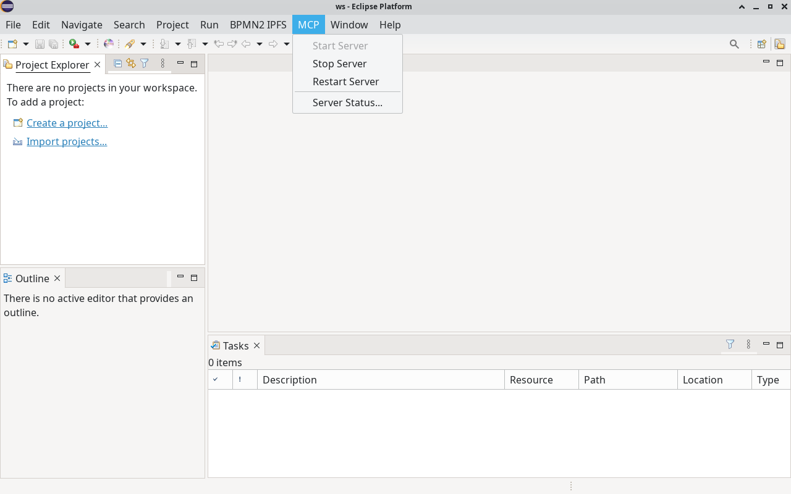

### The files in ~/.config/eclipse-mcp

```bash
ls -l ~/.config/eclipse-mcp ~/.config/eclipse-mcp/instances
```

```
/home/alfa/.config/eclipse-mcp:
total 40
drwxrwxr-x 2 alfa alfa  4096 Oct 22 22:46 instances
-rw-rw-r-- 1 alfa alfa    40 Oct 22 14:37 launcher
-rw------- 1 alfa alfa    49 Oct 22 13:40 token
-rw-rw-r-- 1 alfa alfa 26146 Oct 22 22:57 tools-cache.json

/home/alfa/.config/eclipse-mcp/instances:
total 8
-rw-rw-r-- 1 alfa alfa 338 Oct 22 22:46 8765.json
-rw-rw-r-- 1 alfa alfa 330 Oct 22 22:38 8766.json
```

- `token` holds the bearer token that every request needs. The plug-in writes it on its first start, readable only by you. Anyone with the token controls Eclipse, so treat it like a password.
- `instances/<port>.json` announces a running server. Two Eclipse instances ran during this session, so there are two files. The one on port 8765:

  ```
  {"name":"eclipse-mcp","version":"0.1.0.202610221538","url":"http://127.0.0.1:8765","mcp":"http://127.0.0.1:8765/mcp","api":"http://127.0.0.1:8765/api","port":8765,"pid":14260,"workspace":"<workspace>","started":"2026-10-22T15:46:34.333070516Z"}
  ```

- `launcher` and `tools-cache.json` belong to the client. The cache holds the last tool list, which the client offers while Eclipse is not running.

The client `./eclipse-mcp` builds itself on its first run and then finds the running Eclipse through these files and reads the token, so you never type the token.

## Part 2. Register it with Claude Code

### Through the launcher

```bash
claude mcp add eclipse -s user -- /data2/projects/eclipse-mcp/eclipse-mcp mcp
```

```
Added stdio MCP server eclipse with command: /data2/projects/eclipse-mcp/eclipse-mcp mcp to user config
File modified: /home/alfa/.claude.json
```

```bash
claude mcp list
```

```
eclipse: /data2/projects/eclipse-mcp/eclipse-mcp mcp - ✔ Connected
```

Claude Code reads its servers when a session starts, so start a new session before the tools appear. Their permission names look like `mcp__eclipse__list_projects`. This entry works with whichever Eclipse runs, on any port, and keeps the token out of the configuration.

### Over HTTP

Claude Code can also talk to the plug-in directly:

```bash
claude mcp add --transport http eclipse http://127.0.0.1:8765/mcp \
  --header "Authorization: Bearer $(cat ~/.config/eclipse-mcp/token)"
```

This entry stores the token in the Claude Code configuration and names a fixed port. MCP > Server Status... shows this line and the JSON for other clients, ready to paste (see [Server status](#server-status)).

## Part 3. The MCP menu

### Stop and start the server

1. Choose **MCP > Stop Server**. The server stops and removes its instance file. Now **Start Server** is enabled and **Stop Server** is not.

   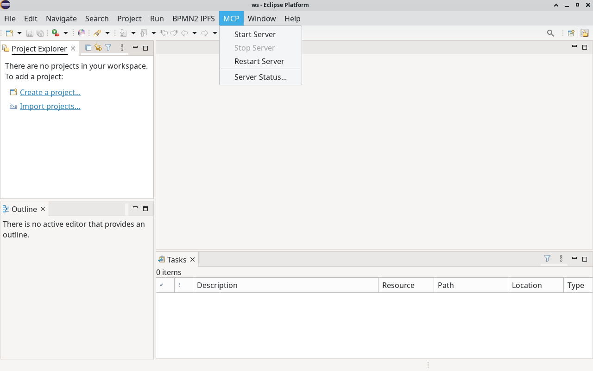

2. The client now reports that nothing answers, with exit code 3:

   ```bash
   ./eclipse-mcp --port 8765 status
   ```

   ```
   Nothing answers at http://127.0.0.1:8765; is Eclipse running with the MCP server started (MCP > Start Server)?
   ```

   Without `--port`, the client looks for any announced Eclipse. When none runs, it says so:

   ```
   No running Eclipse with the MCP plug-in announces itself in /home/alfa/.config/eclipse-mcp/instances. Start Eclipse with the plug-in installed (or MCP > Start Server), or pass a URL or port.
   ```

3. Choose **MCP > Start Server**. The instance file returns, and the client answers again.

**Restart Server** stops and starts the server, which applies a new port from the preferences.

### Server status

**MCP > Server Status...** shows the state, both endpoints, the port, where the token comes from, the instance folder, and the client setups. **Copy Setup** copies the setups to the clipboard.

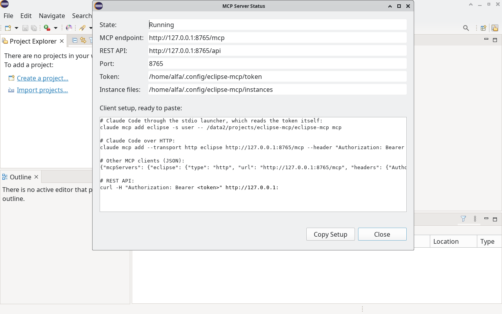

The REST line of the setups contains the real token. The image above masks it; mask it as well before you share a screenshot of this dialog.

### Preferences

**Window > Preferences > MCP Server** holds two settings, stored per workspace:

- **Start the server when Eclipse starts**, on by default. Off means the server waits for **MCP > Start Server**.
- **Port**, 8765 by default: the first port the server tries.

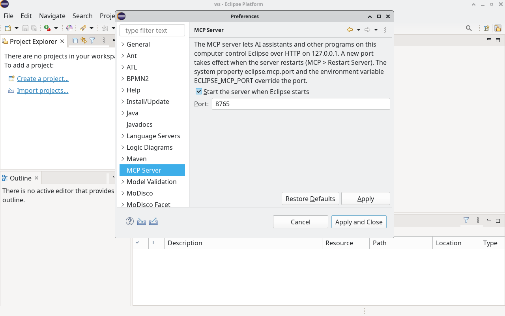

The system property `eclipse.mcp.port` and the environment variable `ECLIPSE_MCP_PORT` override the port. With either one set, the server fails rather than move to another port. The README lists the other overrides.

## Part 4. The command line

`./eclipse-mcp` takes a command and its arguments; `./eclipse-mcp help` lists all of them. Most commands call one tool of the plug-in.

### Pick the Eclipse to talk to

Several Eclipse instances can run at once, for example an IDE and the Eclipse Application it launched:

```bash
./eclipse-mcp instances
```

```
http://127.0.0.1:8765  pid 14260  <workspace>  since 2026-10-22T15:46:34.333070516Z
http://127.0.0.1:8766  pid 13256  <other workspace>  since 2026-10-22T15:38:20.022798988Z
```

Without options, the client takes the newest running instance. While the server on 8765 was stopped in Part 3, a plain `./eclipse-mcp status` therefore answered from the Eclipse on 8766. To pin one instance, put a global option before the command:

```bash
./eclipse-mcp --port 8765 status
./eclipse-mcp --workspace mcp-tutorial status   # the newest whose workspace path contains "mcp-tutorial"
```

The workspace of this tutorial lies in a folder named `mcp-tutorial`, so both commands reach the same Eclipse.

The environment variables `ECLIPSE_MCP_PORT` and `ECLIPSE_MCP_WORKSPACE` do the same. The rest of this tutorial talks to the instance on port 8765 and leaves `--port 8765` out of the listings.

### Menus and dialogs

`menu` reads a menu without opening it:

```bash
./eclipse-mcp menu "File > New"
```

```
Project...
Folder
File
Untitled Text File
Example...
Other...  Ctrl+N
```

`click-menu` clicks an item. A modal dialog would block the click until the dialog closes, so the tool waits a moment and then answers with `"finished": false` and the open shells:

```bash
./eclipse-mcp click-menu "File > New > Project..."
```

```
{
  "action": "click File > New > Project...",
  "finished": false,
  "note": "Still running, most likely because it opened a modal dialog. The dialog is among the shells below; read it with list_shells (widgets=true), fill it with set_text or select_tree_item and close it with press_button.",
  "shells": [
    { "index": 0, "title": "ws - Eclipse Platform", "workbenchWindow": true, ... },
    { "index": 1, "title": "New Project", "default": true, "active": true, "modal": true,
      "parent": 0, "defaultButton": "Finish (disabled)", ... }
  ]
}
```

(The `bounds` of each shell are left out here.) The other dialog commands act on the shell marked `default`, the innermost modal dialog. Create a project with them:

1. Read the dialog:

   ```bash
   ./eclipse-mcp shells --widgets
   ```

   ```
   #0 ws - Eclipse Platform
   #1 New Project [default] [modal]
     widget #3 Label
     widget #6 Label Wizards:
     widget #11 Text type filter text
     widget #13 Tree
     ...
     widget #20 Button < Back (disabled)
     widget #21 Button Next > (disabled)
     widget #22 Button Cancel
     widget #23 Button Finish (disabled)
     ...
   ```

2. Select the wizard and go to the next page:

   ```bash
   ./eclipse-mcp tree "General > Project"
   ./eclipse-mcp press "Next >"
   ```

3. Fill in the name. `set-text` fills the first input field of the dialog, unless told otherwise, and fires the events that typing would, so the wizard enables **Finish**:

   ```bash
   ./eclipse-mcp set-text demo
   ```

   ```
   {
     "shell": "New Project",
     "widget": 8,
     "type": "Text",
     "text": "demo",
     "defaultButton": "Finish"
   }
   ```

   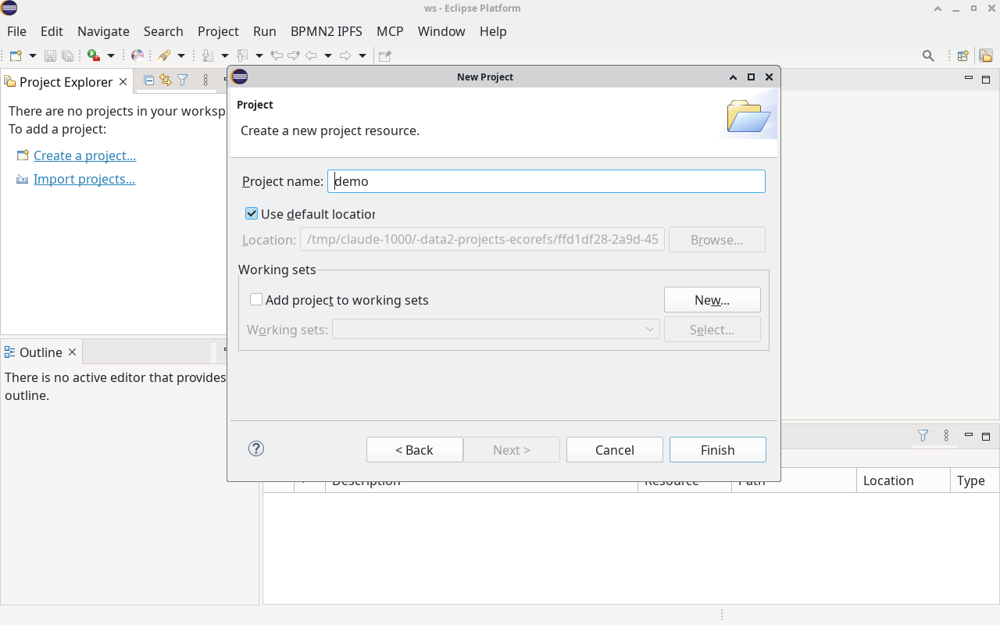

4. Finish:

   ```bash
   ./eclipse-mcp press Finish
   ./eclipse-mcp projects
   ```

   ```
   demo  (0 errors, 0 warnings)  <workspace>/demo
   ```

### Workspace and problems

The outputs of this section come from later in the session, with the payment process of Part 5 open.

```bash
./eclipse-mcp status
```

```
Eclipse MCP 0.1.0.202610221538 at http://127.0.0.1:8765 (33 tools)
Eclipse 4.24.0.v20220607-0700, Java 17.0.20.1
Workspace <workspace> with 1 projects
Window: ws - demo/payment-process.bpmn - Eclipse Platform
#0 ws - demo/payment-process.bpmn - Eclipse Platform [default]
```

```bash
./eclipse-mcp projects
./eclipse-mcp problems
```

```
demo  (0 errors, 0 warnings)  <workspace>/demo
0 errors, 0 warnings
```

`problems` takes `--severity error` and `--project <name>`. Part 5 shows it with real problems.

### Screenshots

```bash
./eclipse-mcp screenshot window.png --target window
```

```
Saved <current folder>/window.png: the window "ws - demo/payment-process.bpmn - Eclipse Platform"
```

The client prints the absolute path of the file. `--target` takes `window`, `shell`, `widget` or `screen`, and `--scale 0.5` halves the size. This is the file from the command above:

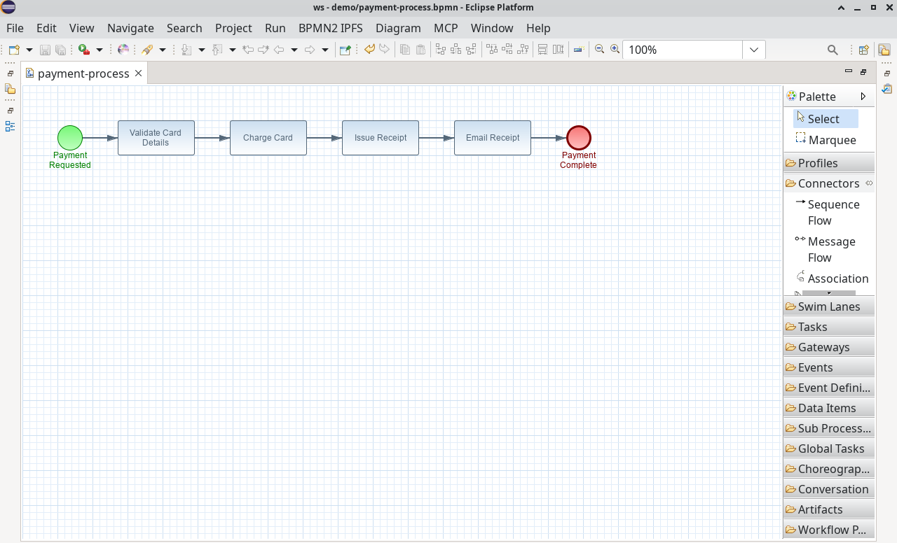

### Any tool with call

`call` runs any tool by name, with `key=value` arguments whose values keep their JSON type:

```bash
./eclipse-mcp call list_menu path=MCP
```

```
{
  "menu": "MCP",
  "items": [
    {
      "label": "Start Server",
      "enabled": false
    },
    {
      "label": "Stop Server"
    },
    {
      "label": "Restart Server"
    },
    {
      "label": "Server Status..."
    }
  ]
}
```

`./eclipse-mcp tools` lists the tool names, and `./eclipse-mcp tools <name>` prints one tool's schema.

## Part 5. Edit a BPMN diagram

The diagram tools are written for Graphiti editors and were tried here with the BPMN2 Modeler, where the element ids are the BPMN ids, such as `Task_ChargeCard`. This part edits a copy of the payment process from the ecorefs case study.

### Open the model

1. Copy the model into the project and refresh the project:

   ```bash
   cp /data2/projects/ecorefs/examples/case-study/payment-process.bpmn <workspace>/demo/
   ./eclipse-mcp refresh /demo
   ./eclipse-mcp open /demo/payment-process.bpmn
   ```

   ```
   Refreshed /demo
   {
     "action": "open /demo/payment-process.bpmn",
     "finished": false,
     "note": "Still running, most likely because it opened a modal dialog. ...",
     "shells": [
       { "index": 0, "title": "ws - demo/payment-process.bpmn - Eclipse Platform", "default": true, ... }
     ]
   }
   ```

2. `"finished": false` means a dialog blocks the editor. The file has no diagram layout, so the BPMN2 Modeler asks which elements to draw. The dialog opened just after the report, which is why the report lists only the main window. Read the shells again:

   ```bash
   ./eclipse-mcp shells --widgets
   ```

   ```
   #0 ws - demo/payment-process.bpmn - Eclipse Platform
   #1 BPMN2 Modeler - Missing Diagram Elements [default] [modal]
     widget #2 Label These items do not have Diagram Elements and can not be shown in the editor.
   Please select the items for which you would like to create Diagram Elements.
     widget #3 Tree
     widget #5 Button Select All
     widget #6 Button Deselect All
     ...
     widget #12 Button Cancel
     widget #13 Button OK
   ```

   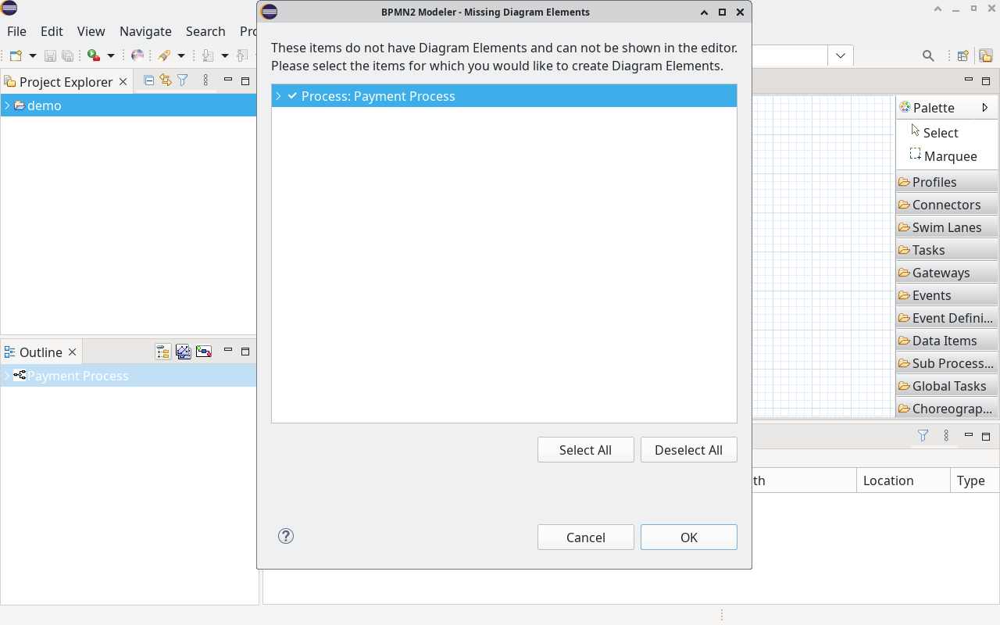

3. Confirm, then save with the keyboard:

   ```bash
   ./eclipse-mcp press OK
   ./eclipse-mcp keys ctrl+s
   ```

   The save answers with a new dialog among the shells: the modeler offers to add its project nature to `demo`.

   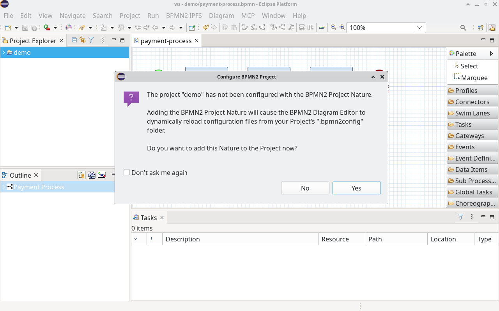

4. Accept it, and maximize the editor:

   ```bash
   ./eclipse-mcp press Yes
   ./eclipse-mcp keys ctrl+m
   ```

### List the elements

```bash
./eclipse-mcp diagram
```

```
payment-process  /demo/payment-process.bpmn
  StartEvent_Payment  StartEvent  "Payment Requested"  at 50,57 size 36x36
  Task_ValidateCard  Task  "Validate Card Details"  at 136,50 size 110x50
  Task_ChargeCard  Task  "Charge Card"  at 296,50 size 110x50
  Task_IssueReceipt  Task  "Issue Receipt"  at 456,50 size 110x50
  EndEvent_PaymentComplete  EndEvent  "Payment Complete"  at 616,57 size 36x36
  Flow_P1  SequenceFlow  StartEvent_Payment -> Task_ValidateCard
  Flow_P2  SequenceFlow  Task_ValidateCard -> Task_ChargeCard
  Flow_P3  SequenceFlow  Task_ChargeCard -> Task_IssueReceipt
  Flow_P4  SequenceFlow  Task_IssueReceipt -> EndEvent_PaymentComplete
```

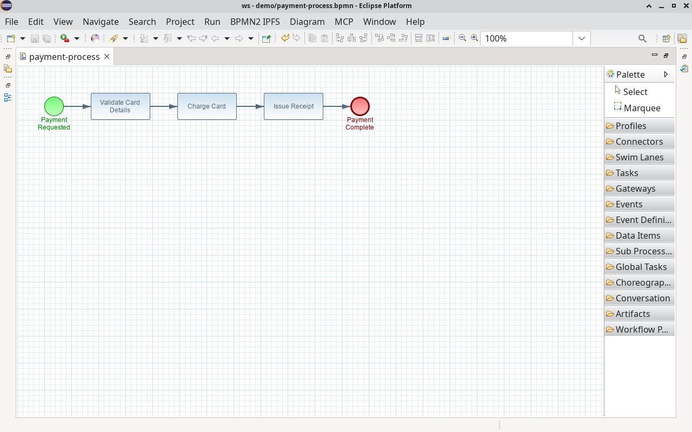

Positions are diagram coordinates. `diagram-move` puts the top-left corner of a shape at the given point. `diagram-create` drops the palette tool at the given point the way a click would, and the BPMN2 Modeler centres the new shape on that point.

`diagram --palette` adds the palette tools that `diagram-create` and `diagram-connect` take, 67 in the BPMN2 Modeler:

```bash
./eclipse-mcp diagram --palette
```

```
...
palette:
  Sequence Flow  connection  (Connectors)
  Message Flow  connection  (Connectors)
  Association  connection  (Connectors)
  Data Association  connection  (Connectors)
  Conversation Link  connection  (Connectors)
  Lane  shape  (Swim Lanes)
  Participant  shape  (Swim Lanes)
  Task  shape  (Tasks)
  Manual Task  shape  (Tasks)
...
```

### Feature mode

Feature mode is the default. It runs the editor's own Graphiti features through its command stack, the same code that the palette runs. The steps below add a task between Issue Receipt and Payment Complete.

1. Make room, then create the task:

   ```bash
   ./eclipse-mcp diagram-move EndEvent_PaymentComplete 776 57
   ./eclipse-mcp diagram-create Task 616 50 --name "Send Receipt"
   ```

   Each change reports what it created, changed and removed. The create:

   ```
   {
     "created": [
       {
         "id": "Task_1",
         "type": "Task",
         "name": "Send Receipt",
         "bounds": {
           "x": 561,
           "y": 25,
           "width": 110,
           "height": 50
         }
       }
     ],
     "changed": [],
     "removed": [],
     "dirty": true,
     "action": "create Task",
     "result": "Created Task; Set name of Task_1"
   }
   ```

   The task is centred on 616,50, so it sits half above the row:

   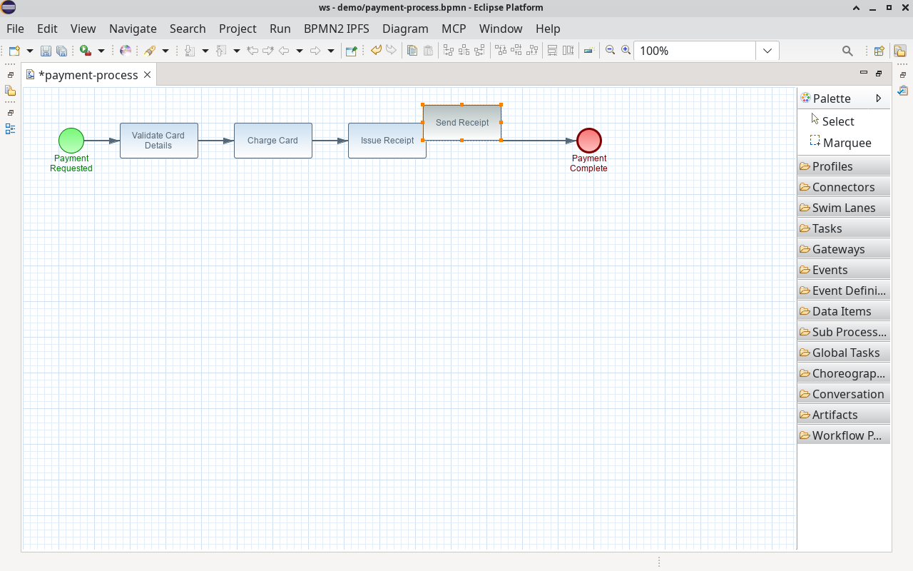

2. Move it into the row, replace the old flow with two new ones, and rename the task:

   ```bash
   ./eclipse-mcp diagram-move Task_1 616 50
   ./eclipse-mcp diagram-delete Flow_P4
   ./eclipse-mcp diagram-connect Task_IssueReceipt Task_1
   ./eclipse-mcp diagram-connect Task_1 EndEvent_PaymentComplete
   ./eclipse-mcp diagram-rename Task_1 "Email Receipt"
   ```

   The results, one per command:

   ```
   "result": "Moved Task_1"
   "result": "Deleted Flow_P4"
   "result": "Connected Task_IssueReceipt to Task_1 with Sequence Flow"
   "result": "Connected Task_1 to EndEvent_PaymentComplete with Sequence Flow"
   "result": "Set name of Task_1"
   ```

   `diagram-connect` uses the Sequence Flow tool unless `--tool` names another. The new flows are `SequenceFlow_1` and `SequenceFlow_2`:

   ```
     Task_1  Task  "Email Receipt"  at 616,50 size 110x50
     ...
     SequenceFlow_1  SequenceFlow  Task_IssueReceipt -> Task_1
     SequenceFlow_2  SequenceFlow  Task_1 -> EndEvent_PaymentComplete
   ```

   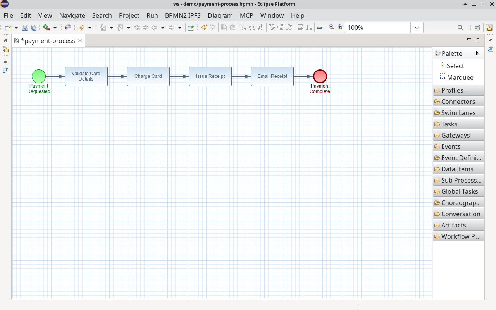

### Mouse mode

`--mode mouse` makes the same changes with the real mouse: the tool clicks the palette and the canvas, or drags the shape, through the X server. Use it for demos and screenshots, since every step is visible.

1. Create a task:

   ```bash
   ./eclipse-mcp diagram-create Task 511 225 --name "Log Payment" --mode mouse
   ```

   ```
   "result": "Clicked the palette tool Task, then the canvas at 511,225; Set name of Task_2"
   ```

   The palette shows the Tasks drawer that the tool opened:

   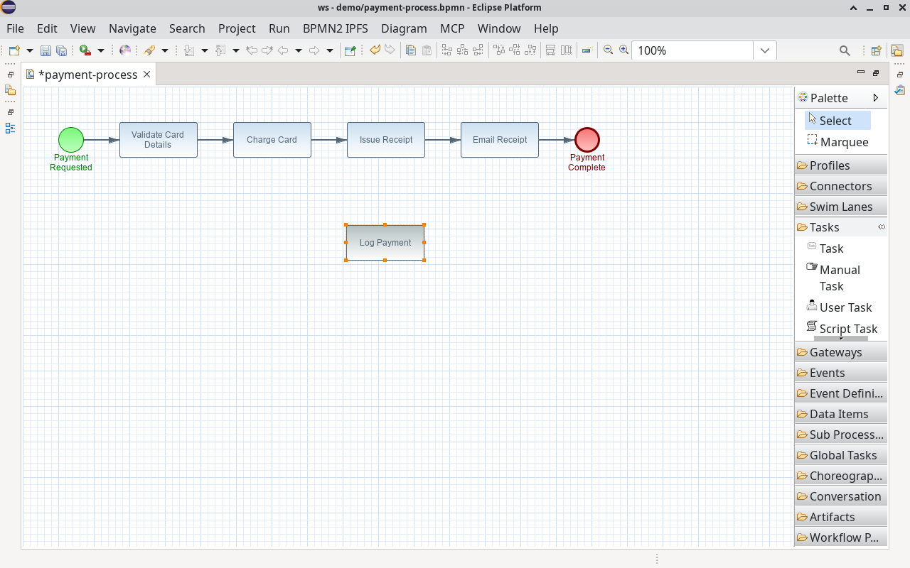

2. Connect it with the Sequence Flow tool of the palette:

   ```bash
   ./eclipse-mcp diagram-connect Task_IssueReceipt Task_2 --mode mouse
   ```

   ```
   "result": "Clicked the palette tool Sequence Flow, then Task_IssueReceipt and Task_2"
   ```

   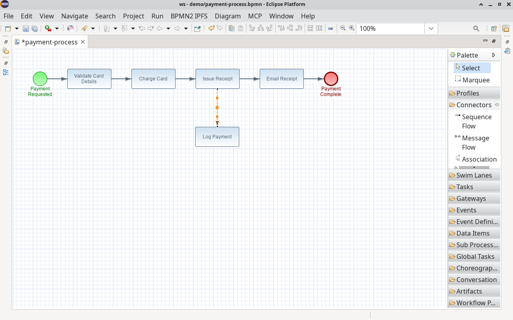

3. Drag it below Email Receipt:

   ```bash
   ./eclipse-mcp diagram-move Task_2 616 270 --mode mouse
   ```

   ```
   "result": "Dragged Task_2 to 616,270"
   ```

   During the drag, the editor shows its usual dashed outline at the mouse position:

   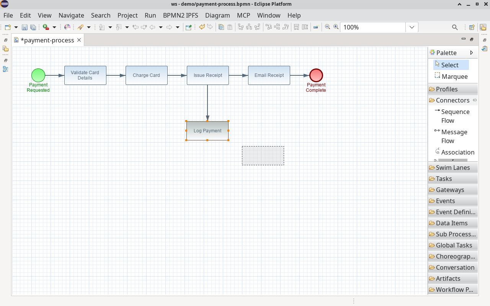

   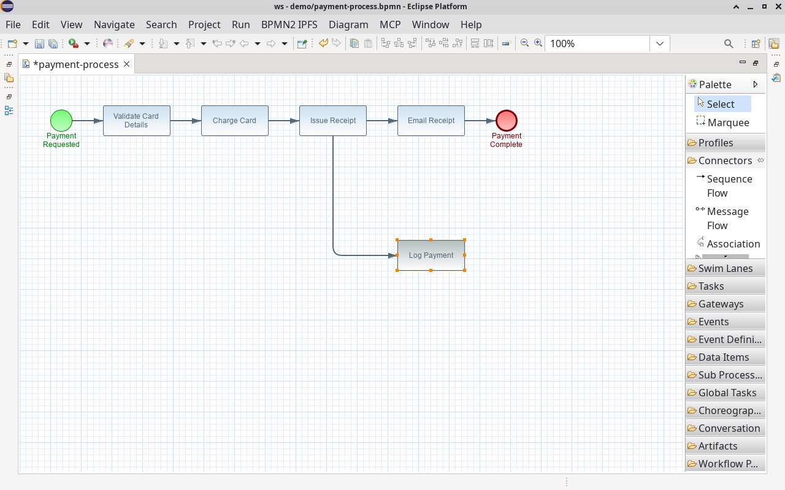

### Rename, delete and check the model

Rename and delete always run the editor's features; they have no mouse mode.

1. Save and look at the problems. The modeler validates the model on save, and Log Payment has no outgoing flow:

   ```bash
   ./eclipse-mcp keys ctrl+s
   ./eclipse-mcp problems
   ```

   ```
   1 errors, 1 warnings
   error  /demo/payment-process.bpmn:76  Task Log Payment has no Outgoing Connections
   warning  /demo/payment-process.bpmn:58  Task should have only one outgoing Sequence Flow
   ```

2. Rename the task:

   ```bash
   ./eclipse-mcp diagram-rename Task_2 "Archive Payment"
   ```

   The editor marks both tasks that the problems name:

   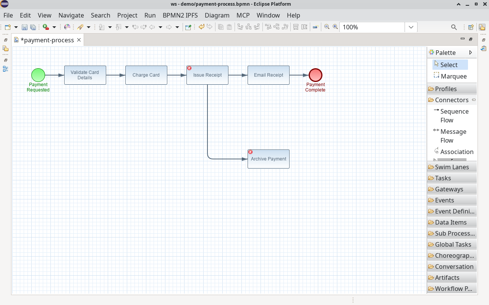

3. Delete it. The delete also removes the flow that ends at the task, without the confirmation dialog of the editor:

   ```bash
   ./eclipse-mcp diagram-delete Task_2
   ```

   ```
   {
     "created": [],
     "changed": [],
     "removed": [
       "Task_2",
       "SequenceFlow_3"
     ],
     "dirty": true,
     "action": "delete Task_2",
     "result": "Deleted Task_2"
   }
   ```

4. Save again:

   ```bash
   ./eclipse-mcp keys ctrl+s
   ./eclipse-mcp problems
   ```

   ```
   0 errors, 0 warnings
   ```

   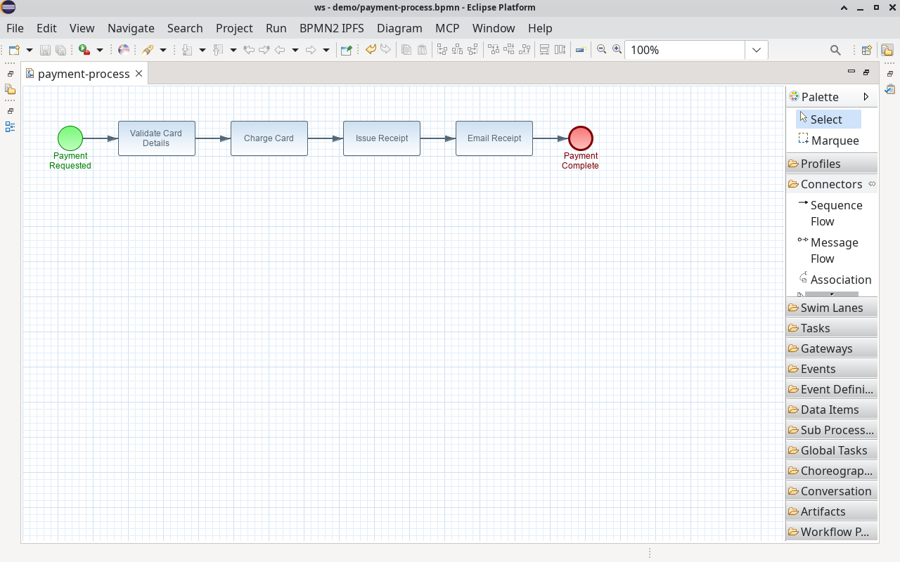

The other diagram commands are `diagram-resize`, `diagram-set` for an attribute of the business object, and `diagram-select`. [CLI.md](CLI.md) lists their arguments.

## Part 6. Use it from an AI assistant

### The tools

Through `./eclipse-mcp mcp`, an assistant sees 33 tools. The `tools/list` answer of the stdio server marks ten of them as read-only (`readOnlyHint`):

| Area | Tools (read-only ones in bold) |
|---|---|
| Workspace | **`eclipse_status`**, **`list_projects`**, **`get_problems`**, `refresh`, `build`, `open_file`, `select_resource` |
| Commands and menus | **`list_commands`**, `run_command`, **`list_menu`**, `click_menu` |
| Dialogs | **`list_shells`**, `press_button`, `set_text`, `select_tree_item`, **`list_tree_items`** |
| Screen and input | **`screenshot`**, `mouse_click`, `mouse_drag`, `type_text`, `press_keys` |
| Launches | **`list_launch_configurations`**, `launch`, `terminate_launch` |
| Diagrams | **`diagram_info`**, `diagram_select`, `diagram_create`, `diagram_move`, `diagram_resize`, `diagram_delete`, `diagram_connect`, `diagram_rename`, `diagram_set_property` |

The CLI commands of Parts 4 and 5 are thin wrappers over these tools: `projects` calls `list_projects`, `diagram-create` calls `diagram_create`, and so on. [MCP.md](MCP.md) describes the arguments.

### Example requests

The stdio server speaks JSON-RPC on standard input and output, so the calls an assistant makes can also be typed by hand. The answers below come from such calls:

```bash
printf '%s\n' \
  '{"jsonrpc":"2.0","id":1,"method":"initialize","params":{"protocolVersion":"2025-06-18","capabilities":{},"clientInfo":{"name":"tutorial","version":"1"}}}' \
  '{"jsonrpc":"2.0","method":"notifications/initialized"}' \
  '{"jsonrpc":"2.0","id":3,"method":"tools/call","params":{"name":"list_projects","arguments":{}}}' \
  | ./eclipse-mcp mcp
```

A request such as "Which projects in my workspace have errors?" needs `list_projects`, and `get_problems` with `severity: "error"` for the details. `list_projects` answers:

```
{
  "projects": [
    {
      "name": "demo",
      "open": true,
      "location": "<workspace>/demo",
      "natures": [
        "org.eclipse.bpmn2.modeler.core.bpmn2Nature"
      ],
      "errors": 0,
      "warnings": 0
    }
  ]
}
```

"In the open diagram, add a task Email Receipt between Issue Receipt and Payment Complete" needs `diagram_info` to find the ids and positions, then `diagram_move`, `diagram_create`, `diagram_delete`, `diagram_connect` and `diagram_rename`, the same steps as [Feature mode](#feature-mode). `diagram_info` returns the editor, the file, the palette, the shapes and the connections, for example:

```
{
  "editor": "payment-process",
  "file": "/demo/payment-process.bpmn",
  "dirty": false,
  "canvasScreenBounds": { "x": 32, "y": 122, "width": 1083, "height": 648 },
  "palette": [
    { "label": "Sequence Flow", "drawer": "Connectors", "kind": "connection" },
    ...
```

"Show me the Eclipse window" needs `screenshot` with `target: "window"`. With `scale: 0.5`, the answer holds a text part and the picture itself as an `image/png` item, which the assistant can look at:

```
{
  "captured": "the window \"ws - demo/payment-process.bpmn - Eclipse Platform\"",
  "screenBounds": { "x": 0, "y": 0, "width": 1280, "height": 776 },
  "scale": 0.5,
  "bytes": 69814
}
```

### Permissions

The ten read-only tools are safe to allow without asking. The others change the IDE or the workspace. `run_command`, `click_menu` and `launch` can do anything Eclipse can, including running programs, so keep them on ask.

## Troubleshooting

- **`Nothing answers at http://127.0.0.1:8765`** (exit code 3). The server on that port is stopped or Eclipse is not running. Choose **MCP > Start Server**, or start Eclipse.
- **`No running Eclipse with the MCP plug-in announces itself`** (exit code 3). No server runs at all. Check that the jars sit in `dropins` and that Eclipse was restarted after the install.
- **The answer comes from the wrong Eclipse.** The client takes the newest running instance. Check with `./eclipse-mcp instances` and pin one with `--port`, `--workspace` or `ECLIPSE_MCP_PORT`.
- **A command answers `"finished": false`.** A modal dialog is open. Read it with `./eclipse-mcp shells --widgets`, then use `set-text`, `tree` and `press`. A dialog can open just after the report, as in [Open the model](#open-the-model), so read the shells again when the report lists only the main window.
- **A new shape lands half off its row.** `diagram-create` takes the drop point, which the BPMN2 Modeler uses as the centre of the shape. `diagram-move` takes the top-left corner.
- **The tools do not show up in Claude Code.** Claude Code reads its servers when a session starts. Open a new session after `claude mcp add`.
- **Screenshots, clicks or keys fail under Wayland.** Start Eclipse with `GDK_BACKEND=x11`.
- **A screenshot of MCP > Server Status... shows the token.** The REST line of the client setups contains it. Mask it before you share the picture.
